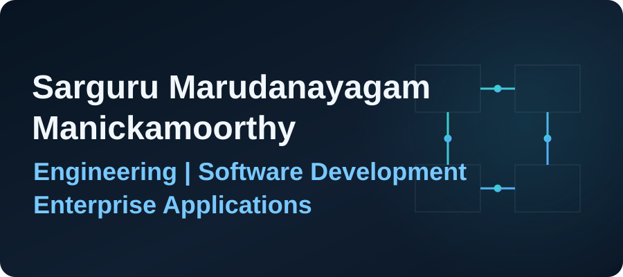
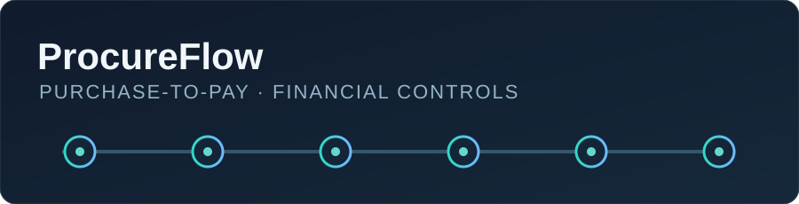
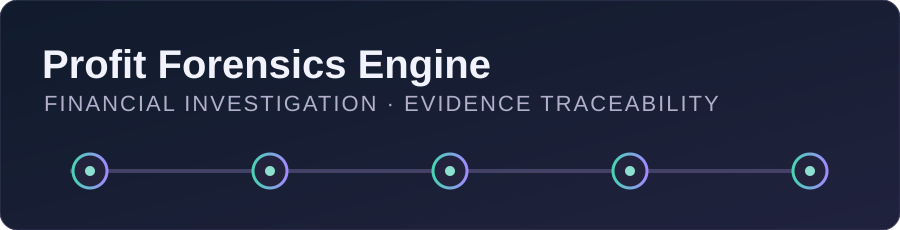

  

<h1 align="center">Engineering | Software Development | Enterprise Applications</h1>

  
  
  
  
  
  

<strong>Building practical software while learning how enterprise workflows connect people, data and systems.</strong>

## About me

I’m Sarguru Marudanayagam Manickamoorthy. I’m developing technical and techno-functional capabilities across software development, backend APIs, databases, ERP processes and enterprise application integration. I’m interested in how reliable software and clear process design can solve practical business problems.

My projects are independent implementations for learning and demonstration. I’m currently expanding my knowledge of Oracle Fusion Cloud ERP and related enterprise technologies; I don’t claim Oracle implementation or consulting experience.

## Technical skills

**Used in my projects**

`Python` · `FastAPI` · `Pydantic` · `SQLAlchemy` · `SQLite` · `SQL` · `React` · `TypeScript` · `Next.js` · `Tailwind CSS` · `React Flow` · `LangGraph` · `Docker` · `Playwright`

**Foundations and development practice**

`Java fundamentals` · `JavaScript fundamentals` · `Relational database concepts` · `Database design fundamentals` · `CRUD` · `Data validation` · `Data reconciliation` · `REST APIs` · `HTTP and JSON` · `Responsive UI` · `Component-based development` · `Git and GitHub` · `API testing` · `Deployment fundamentals`

## Featured projects

### ProcureFlow

**ERP Procure-to-Pay Management & Reconciliation System**

An ERP-inspired procurement and accounts payable application designed around the Procure-to-Pay business workflow. It connects suppliers, requisitions, purchase orders, goods receipts, invoices, approvals, payments and reconciliation in a locally runnable simulation.

**Demonstrates:** supplier and purchasing records; goods receipt management; duplicate invoice detection; two-way and three-way matching; invoice exceptions and approvals; partial and full payment processing; financial reconciliation; SQL reporting; CSV import and export. Financial values use integer paise, with validation and audit history in the FastAPI backend.

**Stack:** Python · FastAPI · React · TypeScript · SQLAlchemy · SQLite · Pydantic · SQL · Playwright

**Business relevance:** shows how procurement and accounts payable transactions connect through an ERP-style workflow, with transaction validation, financial controls, invoice reconciliation and reporting.

<a href="https://github.com/Aadersh2996/procureflow-p2p">Repository</a> · <a href="https://github.com/Aadersh2996/procureflow-p2p/blob/main/docs/demo/ProcureFlow_Demo.mp4">Demonstration video</a> · <a href="https://github.com/Aadersh2996/procureflow-p2p/blob/main/docs/demo/DEMO_WALKTHROUGH.md">Walkthrough and data notes</a>

  
  

Independent ERP workflow simulation. It is not an Oracle Fusion implementation or Oracle integration.

### Profit Forensics Engine

**AI-Assisted Financial Analytics and Investigation Platform**

A financial investigation workspace developed for the Razorpay AI Buildathon. It helps operations teams investigate transaction data and identify evidence-backed financial recovery opportunities.

**Demonstrates:** CSV ingestion; read-only Razorpay REST synchronization; HMAC-verified Razorpay webhooks; payment and subscription recovery investigations; refund and discount leakage analysis; invoice revenue collection investigation; evidence-linked case files; estimated financial impact analysis; an interactive dashboard, timeline and executive reporting.

**Deterministic by design:** fixed routing selects specialized investigators, rule-based analysis derives findings and confidence, and code calculates financial impact. An optional LLM can synthesize report narrative; it does not calculate money, confidence, routing or anomalies.

**Stack:** Python · FastAPI · LangGraph · SQLAlchemy · SQLite · Pydantic · Next.js · React · Tailwind CSS · React Flow · Docker

**Business relevance:** financial technology, transaction data analysis, backend development, database management, API integration, workflow orchestration and AI-assisted business applications.

<a href="https://github.com/Aadersh2996/profit-forensics-engine">Repository</a> · <a href="https://github.com/Aadersh2996/profit-forensics-engine/blob/master/demo/JUDGING_GUIDE.md">Demo walkthrough</a>

The project repository currently contains screenshot placeholders rather than captured product screenshots, so this profile uses an illustrative project card.

## Enterprise applications & ERP learning

Currently expanding my knowledge of Oracle Fusion Cloud ERP, enterprise workflows, application integrations and data-driven business solutions.

These are **current learning areas** rather than claimed implementation experience:

Oracle Fusion Cloud ERP and Procure-to-Pay

- Oracle Fusion Cloud Applications overview; Oracle Fusion Financials and Procurement
- Accounts Payable (AP), Accounts Receivable (AR), General Ledger (GL)
- Supplier management, purchase order management and invoice processing
- Payment processing and Procure-to-Pay lifecycle: requisition, supplier selection, purchase order, receipt, invoice validation, three-way match, approval and payment

Oracle Integration Cloud and application connectivity

- Oracle Integration Cloud (OIC) fundamentals; middleware and application connectivity
- REST API integration; HTTP communication; JSON and XML data exchange
- Data mapping, integration monitoring and error handling
- SOAP web services fundamentals

Reporting and data management

- SQL-based data analysis, data validation and data reconciliation
- OTBI and BI Publisher fundamentals
- PL/SQL fundamentals

## Functional and business-process focus

Developing knowledge and interest in business process analysis, requirement gathering, process documentation and mapping, workflow analysis, data analysis, functional testing, test case preparation, user acceptance testing (UAT), issue identification and troubleshooting.

## Currently learning

Oracle Fusion Cloud ERP workflows · Oracle Integration Cloud patterns · enterprise application integration · OTBI and BI Publisher reporting · PL/SQL, XML and SOAP fundamentals

## Development and collaboration

I value clear requirements, readable documentation, careful data handling and feedback that improves a solution. I’m interested in contributing to practical software and learning from teams that connect technical implementation with business needs.

## Areas of interest

Backend engineering · REST APIs · database management · enterprise applications · ERP and Procure-to-Pay · business process automation · application integration · financial technology · data-driven business solutions

## Professional objective

To develop expertise in enterprise technologies and application development while understanding the business processes that drive organisations. I’m interested in opportunities involving enterprise applications, Oracle Fusion Cloud ERP, backend development, database management, application integration and techno-functional problem solving. I’m focused on continuous learning, practical implementation and building solutions that connect technology with real-world business requirements.

## Contact and GitHub

- GitHub: [@Aadersh2996](https://github.com/Aadersh2996)
- Explore my repositories: [ProcureFlow](https://github.com/Aadersh2996/procureflow-p2p) · [Profit Forensics Engine](https://github.com/Aadersh2996/profit-forensics-engine)
